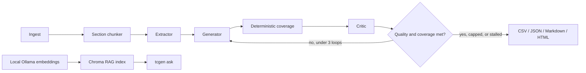

# tcgen

**tcgen** turns a PRD into reviewed, traceable manual test cases without sending
document content to a cloud model provider. LangGraph agents call a local Ollama
server; a deterministic coverage checker and router control the review loop.

## Quickstart (under 10 minutes)

1. Install Python 3.11+ and [Ollama](https://ollama.com/download).
2. Pull the configured local models (the first download can take time):

   ```powershell
   ollama pull qwen2.5:7b-instruct
   ollama pull llama3.1:8b
   ollama pull mistral:7b-instruct
   ollama pull nomic-embed-text
   ```

3. In this directory, create/activate a virtual environment, then install tcgen:

   ```powershell
   py -3.11 -m venv .venv
   .\.venv\Scripts\Activate.ps1
   python -m pip install -e ".[dev]"
   ```

4. Start Ollama if it is not already running, then generate a suite:

   ```powershell
   tcgen run --prd .\tests\data\sample_prd.md --out .\out --no-color
   ```

   Or use Python directly from the project root:

   ```powershell
   python .\src\tcgen\cli.py run --prd .\tests\data\sample_prd.md --out .\out --no-color
   ```

The output directory contains JSON, CSV, Markdown, accessible HTML, and a run report.
Edit [config.yaml](./config.yaml) to change models, thresholds, and local paths. The
configured critic (`mistral`) is a different model family from the generator (`llama`).
Ollama endpoint and role-model names can also be set with `TCGEN_OLLAMA_BASE_URL`,
`TCGEN_EXTRACTOR_MODEL`, `TCGEN_GENERATOR_MODEL`, `TCGEN_CRITIC_MODEL`, and
`TCGEN_EMBEDDINGS_MODEL`.

## Streamlit frontend

Install the optional UI dependency and start the local workbench from the project root:

```powershell
python -m pip install -e ".[ui]"
python -m streamlit run .\frontend\app.py
```

The frontend includes five sample PRDs, custom PRD editing/upload, live agent
progress, refinement scores, coverage and remaining-gap views, report output, local
repository indexing, and cited RAG questions. It uses the same `config.yaml` and
local Ollama endpoint as the CLI; no cloud model calls are added.

## Architecture



All generator/critic/extractor data is passed via a typed LangGraph blackboard. The
router stops at the configured threshold, after two stale scores, or at the hard cap
of three iterations. If gaps remain at the cap, they are retained in the critic and
run-report sections for transparency. More detail is in
[docs/architecture.md](./docs/architecture.md).

## Local repository Q&A

Index code and documentation into local Chroma, then ask a question:

```powershell
tcgen index .
tcgen ask "How does the router decide to stop?"
tcgen eval-rag
```

The index and embeddings remain local. `tcgen ask` cites source file paths and line
ranges; retrieval can be evaluated with the 15-query set in `tests/data/rag_eval.json`.
The RAG commands require the configured embedding model to be available in Ollama.

## Development

```powershell
python -m pip install -e ".[dev]"
ruff check .
ruff format --check .
mypy src
pytest
```

CI runs the same checks with model clients stubbed in tests; no Ollama server or GPU is
needed for unit and integration tests. See the
[user guide](./docs/user-guide.md), [developer guide](./docs/developer-guide.md), and
[tooling notes](./docs/tooling.md), plus the [evaluation guide](./docs/evaluation.md)
for the retrieval score and single-pass versus critic-loop ablation workflow.
