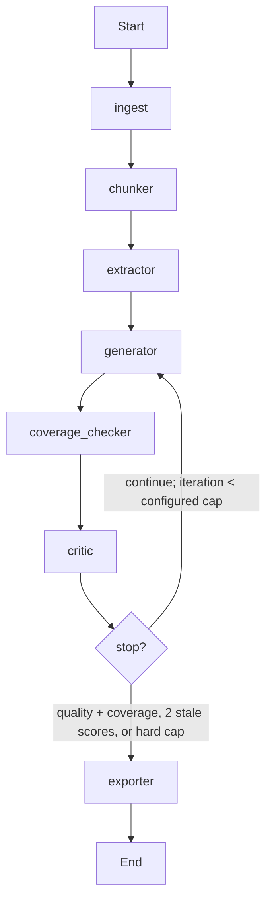

# Architecture

## Graph

Extractor, generator, and critic use separate configured Ollama roles. The graph calls
them sequentially. On a role change the preceding model is unloaded; Ollama's
configurable keep-alive retains only the active role between its own calls. They do not
invoke one another; the shared state is the sole communication channel.

## Blackboard schema

`GraphState` is a `TypedDict`. Every agent-owned payload uses a Pydantic v2 model:

| Blackboard key | Producer | Consumers | Payload |
|---|---|---|---|
| `document` | `ingest` | `chunker` | Parsed source path, text, page text |
| `chunks` | `chunker` | `extractor` | Stable IDs, section path, page, content |
| `requirement_points` | `extractor` | `generator`, `critic`, coverage | Atomic points, class, priority, chunk link |
| `test_cases` | `generator` | `critic`, exporter | Steps, preconditions, test data, expected outcome, req IDs |
| `critique` | `critic` | generator, router | Scores, issues, missing IDs, hallucination risks |
| `coverage` | coverage checker | critic, exporter | Covered/uncovered IDs and case mappings |
| `iteration` | graph | router, exporter | Completed generator/critic cycles |
| `history` | critic | exporter | Append-only snapshots of cases and scores |
| `config` | CLI | nodes | Serialized effective settings |

Every test case is linked to at least one requirement ID; every requirement ID is a
stable hash of normalized requirement text. Chunk IDs are stable hashes of source
location and contents. Malformed structured model responses are repaired conservatively,
retried at most twice, and fail the node explicitly if still invalid. Production agent
calls pass their Pydantic schema to Ollama's JSON-schema structured-output mode rather
than placing the schema text in the prompt; injected test clients can still use plain
JSON responses.

## Loop and coverage

The deterministic checker matches only known requirement IDs. The critic additionally
judges whether a linked scenario semantically exercises the requirement. The router
stops when critic quality and semantic coverage meet their thresholds, after two
consecutive scores that do not improve on the best prior score, or at the configured
limit (`1..5`). Revision passes select critic-flagged cases and missing requirements;
unflagged cases are retained.

## Privacy and run report

Only the configured Ollama base URL is used for model and embedding calls. No hosted
LLM SDK/provider is included. RAG files are split locally and stored in local Chroma.
Reports include configured model names, iteration count, scores, deterministic
coverage, elapsed time, and approximate token estimates (character count divided by
four because Ollama usage metadata is not consistently available).
