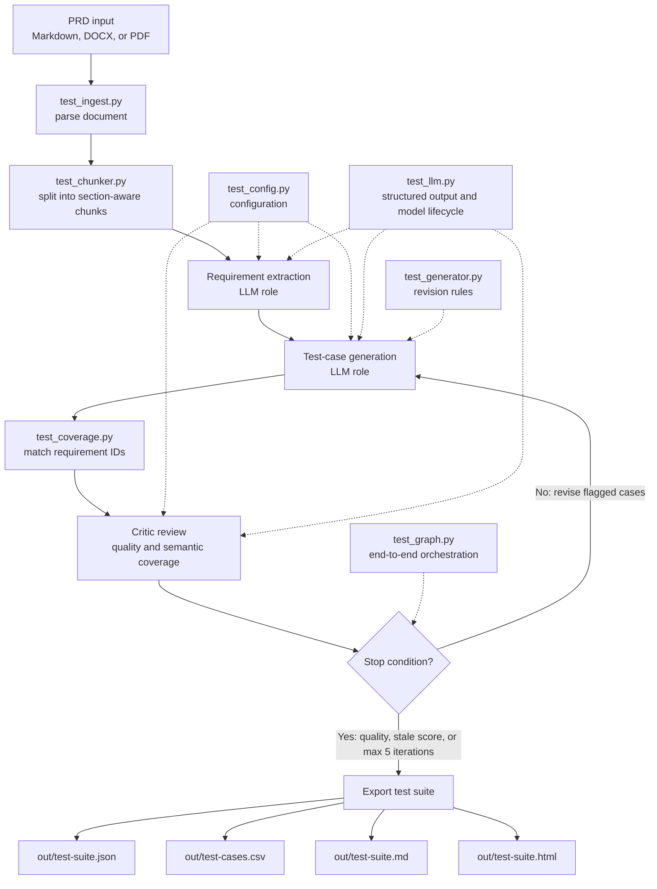
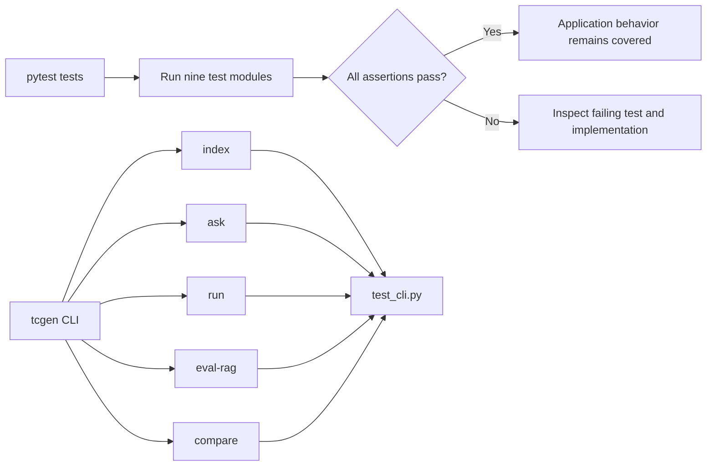
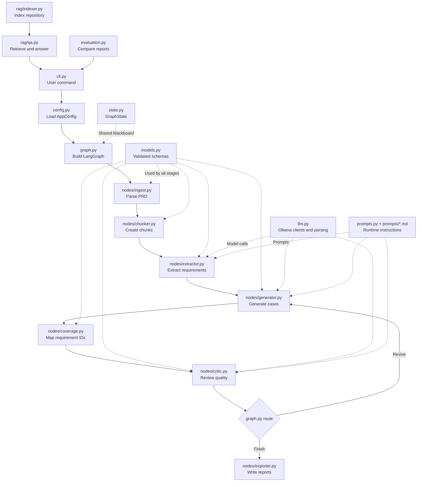

# Test Files and Execution Flow

This guide explains the automated test files in [`tests/`](../tests/) and how
they relate to the PRD-to-test-suite application. These files test the
application itself; they are not the generated test cases shown in
[`out/test-suite.md`](../out/test-suite.md).

## What the application does

The application accepts a product requirements document (PRD), extracts
requirements, generates traceable test cases, checks coverage, asks a critic
model to review the result, and exports a test suite. The sample run uses
[`tests/data/sample_prd.md`](../tests/data/sample_prd.md) as its input.

## Test file summary

| File | Main responsibility | What the tests prove |
|---|---|---|
| [`test_ingest.py`](../tests/test_ingest.py) | PRD input parsing | Markdown and DOCX content, including headings and tables, is preserved; missing, unsupported, and empty documents fail clearly. |
| [`test_chunker.py`](../tests/test_chunker.py) | PRD chunking | Large documents are split into usable chunks while retaining section paths, table rows, numbered hierarchy, and configured overlap. |
| [`test_config.py`](../tests/test_config.py) | Configuration validation | YAML configuration loads correctly, environment overrides work, and invalid settings such as remote Ollama URLs or excessive loop limits are rejected. |
| [`test_llm.py`](../tests/test_llm.py) | LLM integration helpers | Structured JSON responses are repaired and validated, retries stop at the configured limit, role-specific clients are created, and inactive models are unloaded. |
| [`test_generator.py`](../tests/test_generator.py) | Test-case generation | Revision passes replace only flagged cases, avoid unnecessary model calls, and reject results with no positive test case. |
| [`test_coverage.py`](../tests/test_coverage.py) | Requirement traceability | Known requirement IDs are marked as covered, unknown IDs are ignored, and uncovered requirements are reported. |
| [`test_graph.py`](../tests/test_graph.py) | End-to-end generation graph | Ingest, extraction, generation, criticism, coverage, looping, and export work together; the loop stops at five cycles or after stale results. |
| [`test_rag.py`](../tests/test_rag.py) | Local repository search and citations | Files are indexed and filtered correctly, source line ranges are retained, answers cite their sources, and retrieval hit rate is calculated. |
| [`test_cli.py`](../tests/test_cli.py) | Command-line interface | CLI commands can be invoked, direct script execution works outside the project directory, and `index`, `ask`, `run`, `eval-rag`, and `compare` are wired correctly. |

## Detailed explanation

### 1. `test_ingest.py`

This is the first input-boundary test. It calls `parse_document` and checks
that:

- Markdown headings and table text remain available to later processing.
- DOCX paragraphs and tables remain in their original order.
- A missing path raises `FileNotFoundError`.
- An unsupported extension raises a clear `ValueError`.
- A PDF with no extractable text is rejected instead of producing an empty
  document.

### 2. `test_chunker.py`

This protects the conversion from one large PRD into smaller processing
chunks. It checks that chunks retain their section paths and complete table
rows, that requested overlap repeats complete paragraphs, and that long prose
is split while numbered headings remain in the hierarchy.

### 3. `test_config.py`

This protects local configuration behavior. It verifies YAML loading,
environment-variable model overrides, the maximum of five graph iterations,
loopback-only Ollama endpoints, different model families for generator and
critic roles, and explicit errors for malformed top-level YAML.

### 4. `test_llm.py`

This isolates the LLM plumbing without requiring a running Ollama server. It
uses small fake model clients to verify conservative JSON cleanup, Pydantic
schema validation, bounded retries, structured-output calls, role-specific
client creation, and unloading the previous model when switching roles.

### 5. `test_generator.py`

This checks generator behavior after the initial generation and during
revisions. A critique should cause only flagged cases to be replaced while
untouched cases remain. The generator should not call the model when there is
nothing to generate or revise, and it must fail if no positive case is
produced for the requirements.

### 6. `test_coverage.py`

This is the deterministic traceability check. It compares requirement IDs
with the IDs referenced by test cases. It confirms that valid links are
reported, unknown IDs do not create false coverage, and missing requirements
are listed as uncovered.

### 7. `test_graph.py`

This is the main workflow test. It injects fake extractor, generator, and
critic clients, so it exercises the graph without calling real LLMs. It
verifies that:

- A complete run creates JSON, CSV, Markdown, and HTML output.
- Generated test cases point to stable requirement IDs.
- The graph cannot exceed five generator/critic cycles.
- A stalled score stops after the configured stale-iteration rule.

### 8. `test_rag.py`

This covers the local retrieval-augmented generation feature. It checks
language-aware file splitting, one-based source line metadata, exclusion of
virtual environments and oversized files, repository-scoped Chroma records,
failure when an index is missing, source citations in answers, and retrieval
evaluation hit rates.

### 9. `test_cli.py`

This checks the user-facing command layer. It invokes commands through Typer,
stubs the expensive indexing and model operations, and verifies command
outputs and exit codes. It covers direct `cli.py --help` execution,
`index`, `ask`, `run`, `eval-rag`, and the single-pass versus critic-loop
comparison command.

## Why the tests use stubs and temporary files

The tests deliberately avoid depending on a live Ollama server, a running
Chroma service, or the developer's real repository. Fake model clients,
monkeypatching, and pytest temporary directories make the checks:

- deterministic;
- fast enough to run repeatedly;
- safe to run without sending data to a remote service; and
- focused on application logic rather than external service availability.

## Application flow

The following flow shows the production path tested primarily by
`test_graph.py`, with the supporting tests protecting each stage:

## Test and CLI flow

The tests can be run as a group. The CLI tests additionally verify that the
same major operations are reachable from the command line:

## Generated report versus test modules

[`out/test-suite.md`](../out/test-suite.md) is an output artifact, not a
pytest file. It contains four generated scenarios for the sample password
reset PRD, a traceability matrix, coverage results, and the run report. The
test modules verify that the code capable of producing this kind of report
behaves correctly.

## `src/tcgen/` source files

The [`src/tcgen/`](../src/tcgen/) folder contains the application code. It is
separated into shared data/configuration code, LangGraph pipeline nodes, and
repository-search code.

### Main package files

| File | Function | Use |
|---|---|---|
| [`__init__.py`](../src/tcgen/__init__.py) | Defines the package and its version. | Allows Python to import `tcgen` and exposes version `0.1.0`. |
| [`cli.py`](../src/tcgen/cli.py) | Defines the Typer command-line interface. | Provides `run`, `index`, `ask`, `eval-rag`, and `compare` commands for users. |
| [`config.py`](../src/tcgen/config.py) | Loads and validates YAML settings and environment overrides. | Supplies model names, local Ollama settings, chunk limits, quality thresholds, retry limits, and Chroma paths to the rest of the application. |
| [`models.py`](../src/tcgen/models.py) | Defines validated Pydantic data models and enums. | Gives every pipeline stage a consistent structure for documents, chunks, requirements, test cases, critiques, coverage, and iteration history. |
| [`state.py`](../src/tcgen/state.py) | Defines the LangGraph `GraphState` blackboard. | Describes the values that pipeline nodes read and write while processing one PRD. |
| [`graph.py`](../src/tcgen/graph.py) | Builds and connects the LangGraph workflow. | Runs ingest, chunking, extraction, generation, coverage checking, criticism, looping, and export in the correct order. |
| [`llm.py`](../src/tcgen/llm.py) | Creates Ollama clients and validates structured model output. | Keeps model calls local, switches between role-specific models, repairs small JSON formatting issues, retries bounded failures, and validates responses against Pydantic schemas. |
| [`prompts.py`](../src/tcgen/prompts.py) | Loads Markdown prompt templates and replaces placeholders. | Supplies the extractor, generator, critic, and RAG question-answering instructions at runtime. |
| [`evaluation.py`](../src/tcgen/evaluation.py) | Reads and compares saved run metrics. | Produces the `compare` command's report showing how a critic loop differs from a single-pass run. |

### Pipeline node files

The files in [`src/tcgen/nodes/`](../src/tcgen/nodes/) are individual stages
used by [`graph.py`](../src/tcgen/graph.py).

| File | Function | Use |
|---|---|---|
| [`nodes/__init__.py`](../src/tcgen/nodes/__init__.py) | Marks `nodes` as a Python package. | Allows the graph to import the node modules. |
| [`nodes/ingest.py`](../src/tcgen/nodes/ingest.py) | Parses PDF, DOCX, Markdown, and plain-text PRDs. | Converts the selected PRD into a validated `Document`, preserving page boundaries where available. |
| [`nodes/chunker.py`](../src/tcgen/nodes/chunker.py) | Splits a document into section-aware chunks. | Keeps headings, numbered hierarchy, table groups, source metadata, and configurable overlap before LLM extraction. |
| [`nodes/extractor.py`](../src/tcgen/nodes/extractor.py) | Extracts atomic requirements from chunks. | Calls the extractor model, removes duplicate normalized requirements, and assigns stable `req-...` IDs linked to source chunks. |
| [`nodes/generator.py`](../src/tcgen/nodes/generator.py) | Generates and revises test cases. | Creates positive, negative, boundary, or other scenarios linked to requirement IDs; later revisions replace only flagged or missing coverage. |
| [`nodes/coverage.py`](../src/tcgen/nodes/coverage.py) | Calculates deterministic requirement coverage. | Maps each known requirement to test cases and lists uncovered requirements without relying on an LLM. |
| [`nodes/critic.py`](../src/tcgen/nodes/critic.py) | Reviews generated test cases. | Uses the critic model to score quality and semantic coverage and return actionable issues or missing requirement IDs. |
| [`nodes/exporter.py`](../src/tcgen/nodes/exporter.py) | Writes generated suite reports. | Produces `test-suite.json`, `test-cases.csv`, `test-suite.md`, and `test-suite.html` in the selected output folder. |

### RAG files

The files in [`src/tcgen/rag/`](../src/tcgen/rag/) implement local
retrieval-augmented repository questions.

| File | Function | Use |
|---|---|---|
| [`rag/__init__.py`](../src/tcgen/rag/__init__.py) | Marks `rag` as a Python package. | Allows the CLI and other modules to import repository indexing and Q&A functions. |
| [`rag/indexer.py`](../src/tcgen/rag/indexer.py) | Splits repository files, creates embeddings, and stores chunks in Chroma. | Powers `tcgen index`; it excludes virtual environments and other generated folders, records source line ranges, and restricts retrieval to the selected repository. |
| [`rag/qa.py`](../src/tcgen/rag/qa.py) | Retrieves source chunks and asks the generator model for an answer. | Powers `tcgen ask` with source-line citations and `tcgen eval-rag` with retrieval hit-rate measurements. |

### Prompt templates

The Markdown files in [`src/tcgen/prompts/`](../src/tcgen/prompts/) are not
Python modules. They are runtime instructions loaded by `prompts.py`.

| File | Used by | Purpose |
|---|---|---|
| [`prompts/extractor.md`](../src/tcgen/prompts/extractor.md) | `nodes/extractor.py` | Tells the extractor model to find atomic, source-grounded requirements. |
| [`prompts/generator.md`](../src/tcgen/prompts/generator.md) | `nodes/generator.py` | Tells the generator model to produce or revise traceable test cases. |
| [`prompts/critic.md`](../src/tcgen/prompts/critic.md) | `nodes/critic.py` | Tells the critic model how to score quality, coverage, traceability, and risks. |
| [`prompts/rag_qa.md`](../src/tcgen/prompts/rag_qa.md) | `rag/qa.py` | Tells the generator model to answer repository questions using retrieved context. |

## Source-code flow

## Typical execution by command

| Command | Main source path |
|---|---|
| `tcgen run --prd ... --out ...` | `cli.py` → `config.py` → `graph.py` → `nodes/*` → `exporter.py` |
| `tcgen index ...` | `cli.py` → `config.py` → `rag/indexer.py` |
| `tcgen ask "..."` | `cli.py` → `config.py` → `rag/qa.py` → `rag/indexer.py` → local generator model |
| `tcgen eval-rag ...` | `cli.py` → `config.py` → `rag/qa.py` → `rag/indexer.py` |
| `tcgen compare ...` | `cli.py` → `evaluation.py` |
